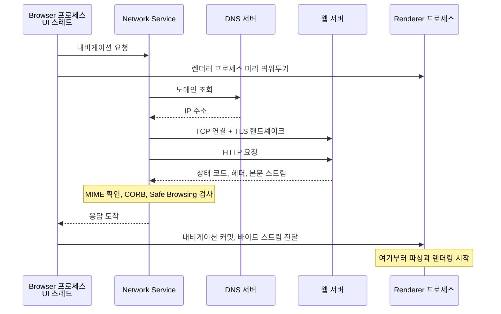
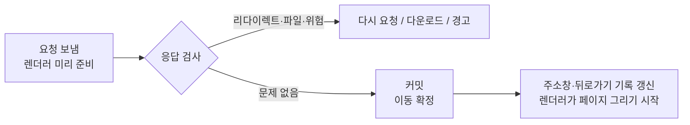

원문 : https://addyo.substack.com/p/how-modern-browsers-work (Addy Osmani, 2025.09)

**브라우저는 HTML/CSS/JS를 마법처럼 화면으로 바꾸는 블랙박스가 아니라, 프로세스·스레드·메모리를 관리하는 작은 운영체제에 가깝다.** URL 입력부터 픽셀이 찍히기까지 네트워크 → 파싱 → 스타일 → 레이아웃 → 페인트 → 컴포지팅 → JS 실행이 어떻게 맞물리는지 알면, "async 스크립트를 써라", "transform으로 애니메이션해라" 같은 성능 권장 사항이 왜 나왔는지 이해할 수 있다.

Chromium(Blink + V8) 기준으로 설명하고, Firefox(Gecko)·Safari(WebKit)는 다른 점만 짚는다. 이 문서는 원문의 1. 네트워킹과 리소스 로딩만 다루고, 파싱부터 엔진 비교까지는 2편에 정리했다.

## 1. 네트워킹과 리소스 로딩: 렌더러는 네트워크에 직접 접근하지 않는다



- 주소창에 URL을 입력하거나 링크를 누르면 **브라우저 프로세스**의 UI 스레드가 내비게이션 요청을 시작한다.
    - **브라우저 프로세스** : 주소창, 탭, 북마크 등 브라우저 UI와 다른 프로세스 전체를 관리하는 메인 프로세스. 웹 페이지 "바깥"에서 일어나는 일은 전부 여기 담당.
- 내비게이션 단계
    1. **URL 파싱 + 보안 체크** : 스킴(http/https), 도메인 파악. 주소창 입력이 검색어인지 URL인지도 여기서 판단. 피싱 차단 목록 확인.
    2. **DNS 조회** : 도메인 → IP 변환(캐시에 없으면). 설정에 따라 DoH(DNS over HTTPS) 사용.
    3. **연결 수립** : TCP 연결, HTTPS면 TLS 핸드셰이크까지.
        - **TLS 핸드셰이크** : 서버가 제시한 디지털 인증서로 신원을 검증하고 암호화에 쓸 키를 교환하는 과정. 이게 끝나야 암호화된 통신 시작 가능.
    4. **HTTP 요청 전송** : 서버가 지원하면 HTTP/2, HTTP/3가 기본. 하나의 연결로 여러 리소스를 동시에 주고받는 멀티플렉싱이 가능해 HTTP/1.1의 "호스트당 동시 연결 약 6개" 제한을 피한다.
    5. **응답 수신** : 상태 코드, 헤더, 본문을 스트림으로 읽음. `Content-Type`이 없거나 틀리면 내용을 보고 타입을 추측(MIME sniffing)함. 보안 장치로 CORB(Cross-Origin Read Blocking), Safe Browsing 검사도 여기서 수행.
        
      
        
        **MIME sniffing, CORB, Safe Browsing**
        
        - MIME sniffing : 브라우저가 응답 헤더 대신 실제 내용을 보고 파일 타입을 추측하는 동작. `X-Content-Type-Options: nosniff` 헤더를 보내면 선언된 `Content-Type`을 그대로 쓰고, `script`·`style` 요청은 MIME 타입이 맞지 않으면 아예 차단한다.
        - CORB : 다른 출처의 HTML/JSON/XML 응답을 ``나 `<script>`로 불러오려 할 때, 그 응답을 페이지에 넘기지 않고 빈 응답으로 바꿔치기하는 장치. Spectre 같은 부채널 공격에 대비한 사이트 격리 보호의 일부다.
        - Safe Browsing : 구글이 계속 갱신하는 위험 사이트 목록(피싱, 악성코드·원치 않는 소프트웨어 배포 사이트)에 URL을 대조하는 서비스. 목록에 걸리면 페이지 대신 경고 화면을 띄운다.
      
        
    6. **리다이렉트** : 301/302면 `Location`으로 다시 요청. 실제 콘텐츠가 담긴 최종 응답을 받아야 다음 단계로 넘어간다.
- 이 작업은 Chromium의 **Network Service**(보통 별도 프로세스)가 담당한다. 페이지 코드를 실행하는 렌더러는 네트워크에 직접 접근하지 못하고 브라우저 쪽에 요청해야 한다 ⇒ 보안상 이점.

### 추측 로딩(Speculative Loading)과 리소스 최적화

- 리소스를 빠르게 받기 위해 브라우저·개발자·서버가 쓰는 방법들을 정리하면 다음과 같다.
    1. **프리로드 스캐너** : 브라우저가 HTML을 미리 훑어서 필요한 리소스를 알아서 찾음
    2. **리소스 힌트** : 개발자가 HTML에 "곧 이게 필요하다"고 적어둠
    3. **Early Hints** : 서버가 HTML보다도 먼저 힌트를 보냄
    4. **Speculation Rules API** : 사용자가 이동할 것 같은 페이지를 미리 받거나 렌더해둠
    5. **HTTP/2, HTTP/3** : 한 연결로 여러 리소스를 동시에 받아 전송 자체를 효율화
    6. **리소스 우선순위** : 받을 리소스들 사이에서 무엇을 먼저 받을지 조정

#### ① 프리로드 스캐너(preload scanner)

- 개발자가 따로 할 일 없이 자동 동작하는 현대 브라우저 성능의 핵심 메커니즘
- 메인 HTML 파서가 CSS나 동기 스크립트 때문에 멈춰 있는 동안, 원시 마크업을 먼저 훑어서 이미지·스크립트·스타일시트를 병렬로 요청해두는 보조 파서.
- **단, JS로 동적으로 주입되는 리소스는 찾지 못한다** ⇒ JS가 ``를 동적으로 넣으면 그 이미지는 프리로드 스캐너의 혜택을 받지 못하고 순차적으로 로드될 가능성이 높다.
    - `HTML 수신 → JS 다운로드 → JS 실행 →  생성 → 그제서야 이미지 요청` 처럼 계단식(waterfall)이 됨 (ex: CSR 앱의 히어로 이미지, JS 슬라이더의 첫 배너)

#### ② 리소스 힌트(Resource Hints)

- 브라우저에게 **"곧 이게 필요하니 미리 준비해두라"고 귀띰하는 신호**. 요청 명령이 아니라 힌트라서 브라우저가 상황에 따라 따르거나 무시한다.
- HTML의 `<link rel="...">`로 쓰거나, 같은 내용을 HTTP 응답 헤더 `Link`로 보낼 수도 있다. (헤더 형태가 ③ Early Hints로 이어진다)
- 브라우저도 자체 예측(주소 입력 중, 링크 hover 시)으로 DNS 조회·연결을 미리 해두기도 하지만, 이는 브라우저 내부 동작이라 개발자가 제어할 수 없다. 리소스 힌트는 개발자가 필요한 리소스를 직접 지정하는 표준 방법이다.

| 힌트 | 미리 하는 일 | 언제 쓰나 |
| --- | --- | --- |
| `dns-prefetch` | DNS 조회만 | 쓸 수도 있는 외부 도메인. 비용이 거의 없음 |
| `preconnect` | DNS + TCP 연결 + TLS 핸드셰이크 | 곧 쓸 게 확실한 중요한 외부 도메인 몇 개 |
| `preload` | 파일 자체를 높은 우선순위로 다운로드 | 이번 페이지에서 꼭 쓰는데 늦게 발견되는 리소스 (CSS 안의 폰트, JS가 넣는 히어로 이미지) |
| `prefetch` | 다음 페이지 리소스를 한가할 때 낮은 우선순위로 다운로드 | 사용자가 다음에 갈 가능성이 높은 페이지의 리소스 |

```html
<head>
  <!-- DNS 조회만 미리 -->
  <link rel="dns-prefetch" href="https://analytics.example.com">

  <!-- DNS + TCP + TLS까지 미리 연결 -->
  <link rel="preconnect" href="https://cdn.example.com">

  <!-- 폰트처럼 CORS로 요청하는 리소스는 crossorigin을 붙여야 한다. 빠지면 DNS 조회만 수행됨 -->
  <link rel="preconnect" href="https://fonts.gstatic.com" crossorigin>

  <!-- JS가 나중에 넣는 히어로 이미지를 미리 받아둠 -->
  <link rel="preload" href="/hero.jpg" as="image" fetchpriority="high">

  <!-- 다음 페이지(장바구니)에서 쓸 JS를 한가할 때 받아둠 -->
  <link rel="prefetch" href="/cart.js">
</head>
```

- `dns-prefetch` / `preconnect`
    - 다른 도메인에 처음 요청할 때 드는 연결 준비 시간을 미리 당겨 리소스 응답시간을 단축시킬 수 있다. 중요한 외부 도메인에 미리 연결해두면 100~500ms 정도 빨라질 수 있다.
    - 곧 요청할 게 확실한 **다른 도메인**(폰트·이미지 CDN, API 서버, 분석 스크립트 등)에 쓴다. 같은 도메인은 이미 연결이 있어서 의미 없음.
    - 주의점
        - `preconnect`는 실제로 연결을 여는 것이라 남발하면 다른 중요한 리소스를 오히려 늦출 수 있음 ⇒ 중요한 도메인 몇 개에만 사용
        - 열어둔 연결을 10초 안에 쓰지 않으면 브라우저가 닫아버린다.
        - `preconnect`를 지원하지 않는 브라우저를 위해 `dns-prefetch`를 함께 쓰는 패턴이 흔하다. 단, `rel="preconnect dns-prefetch"`처럼 한 태그에 합치면 Safari에서 `preconnect`가 취소되는 버그가 있어 **태그를 따로** 써야 한다.
- `preload` / `prefetch`
    - `preload`는 **이번 페이지**용이라 높은 우선순위로 즉시 받고, `prefetch`는 **다음 페이지**용이라 남는 시간에 받는다.
    - `preload`에는 `as`(image, style, script, font 등)가 필수다. 빠지면 Chrome은 preload를 아예 무시하고, 폰트처럼 CORS로 요청되는 리소스는 `crossorigin`까지 맞춰야 실제 요청과 매칭되어 두 번 받지 않는다. 받아놓고 load 이벤트 후 몇 초 안에 쓰지 않으면 Chrome 콘솔에 경고가 뜬다.

#### ③ Early Hints (HTTP 103)

- **리소스 힌트의 한계 : HTML 안에 있으면 HTML이 도착해야 읽힌다.**
    - 서버는 HTML을 만드는 데 시간이 걸린다(DB 조회, 상품 목록 조회, 템플릿 렌더링 등). 이 시간을 **server think-time**이라고 한다.
    - 그동안 브라우저는 받은 게 없으니 아무것도 못 하고 대기한다. 힌트도 여기 묶여 있다.
- **해결 : HTML을 만들기 전에 힌트부터 먼저 보낸다.**
    - 서버는 HTML 내용은 아직 몰라도 "어떤 페이지든 `main.css`와 폰트 도메인은 필요하다"는 건 이미 알고 있다.
    - 그래서 요청을 받자마자 `103` 중간 응답으로 `Link` 헤더(리소스 힌트)를 보내고, HTML이 완성되면 그때 `200` 최종 응답을 보낸다.
    - `103` : "최종 응답은 아니고 미리 알려줄 게 있다"는 의미의 정보성(1xx) 상태 코드

```
HTTP/1.1 103 Early Hints
Link: </style.css>; rel=preload; as=style
Link: <https://cdn.example.com>; rel=preconnect

(서버는 그동안 HTML 생성 중...)

HTTP/1.1 200 OK
Content-Type: text/html
...
```

- **효과 : LCP 개선 가능**
    - **LCP(Largest Contentful Paint)** : 화면에서 가장 큰 콘텐츠(보통 히어로 이미지나 큰 제목)가 그려진 시점. Core Web Vitals 지표 중 하나로, "페이지가 떴다"고 체감하는 순간과 가깝다.
    - LCP 요소를 그리려면 CSS(렌더 블로킹), 히어로 이미지, 이미지·폰트 도메인과의 연결이 필요하다.
    - 원래는 이것들이 전부 HTML 도착 후에 시작됐는데, think-time 동안 미리 시작되므로 그 시간만큼 LCP가 당겨진다 ⇒ 수백 ms, 경우에 따라 1초 가까이 개선된 사례도 있다. 서버가 HTML을 오래 만들수록 효과가 크다.
- **누가 설정하나 : 서버에서 설정**
    - 사용자가 페이지에 들어오면 브라우저는 평소처럼 HTML을 요청할 뿐이고, 서버(또는 CDN)가 그 응답을 103 → 200 순서로 보내는 것. 프론트엔드 JS는 할 일이 없고, 브라우저가 103을 받으면 알아서 처리한다.
    - 서버 코드로 직접 보내거나(ex: Node.js 18.11+의 `res.writeEarlyHints()`, Apache·NGINX 설정), Cloudflare 같은 CDN의 Early Hints 옵션을 켜는 방식으로 쓴다.

```jsx
// Node.js http 서버 예시
import http from 'node:http';

http.createServer(async (req, res) => {
  // ① HTML을 만들기 전에 103부터 보낸다
  res.writeEarlyHints({
    link: [
      '</style.css>; rel=preload; as=style',
      '<https://cdn.example.com>; rel=preconnect',
    ],
  });

  // ② 시간이 걸리는 HTML 생성 (think-time)
  const html = await renderPage(req);

  // ③ 최종 200 응답
  res.writeHead(200, { 'Content-Type': 'text/html' });
  res.end(html);
}).listen(3000);
```

- 제약
    - 내비게이션 요청(페이지 이동)에서만 동작. `fetch` 같은 일반 요청에는 안 됨.
    - `preconnect`와 `preload`만 지원(`prefetch`는 X). Safari는 103으로 `preconnect`만 지원하고 `preload`는 지원하지 않는다.
    - HTTP/2·HTTP/3 연결에서 보내는 것이 권장되고, 대부분의 브라우저도 이 프로토콜에서만 받는다.
    - 103으로 preload한 리소스는 HTTP 캐시에 저장됐다가 쓰이므로, 캐시할 수 있는 리소스여야 두 번 받지 않는다.
    - 서버나 CDN 설정이 필요해서, 서버를 직접 만질 수 없는 호스팅 환경에서는 쓰기 어렵다.

#### ④ Speculation Rules API

- 사용자 행동 패턴에 따라 URL을 미리 prefetch하거나 **prerender**(JS 실행까지 포함한 페이지 전체 미리 렌더)하는 규칙을 JSON으로 정의하는 기능. 사용자가 그 링크를 클릭했을 때 네트워크 요청을 기다리지 않고 미리 준비해둔 페이지를 바로 보여주므로, 페이지 이동이 거의 즉시 일어난다.
    - `prefetch` : 다음 페이지의 HTML 문서만 받아둠. 그 안의 하위 리소스는 받지 않음.
    - `prerender` : 보이지 않는 탭에서 하위 리소스 로딩, JS 실행까지 끝내둠.
- 리소스 힌트의 `<link rel="prefetch">`가 다음 페이지에서 쓸 **파일 하나**를 캐시에 받아두는 것이라면, Speculation Rules는 사용자가 **이동할 페이지 자체**를 준비한다. `prefetch`는 그 페이지의 HTML 문서만, `prerender`는 하위 리소스와 JS 실행까지 포함해 페이지 전체를 미리 만들어둔다.
- 브라우저는 규칙을 읽으면 기억해두고, 링크가 `eagerness` 조건(hover, 클릭 시작 등)을 만족하는 순간에 그 링크의 페이지를 미리 받기 시작한다.

**규칙을 심는 방법 3가지**

- 세 가지 모두 효과는 같고, 배포 방식과 유연성이 다르다. 섞어 써도 된다.

| 방식 | 어떻게 | 브라우저가 읽는 시점 | 언제 쓰나 |
| --- | --- | --- | --- |
| HTML에 직접 | 템플릿에 `<script type="speculationrules">` 넣기 | HTML 파서가 그 태그를 만났을 때 | 사이트 전체에 고정 규칙을 깔 때 |
| JS로 삽입 | 같은 `<script>`를 JS로 만들어 DOM에 붙이기 | 태그가 DOM에 붙는 순간 | 사용자 행동에 따라 동적으로, 태그 매니저로 배포할 때 |
| HTTP 헤더 | `Speculation-Rules: "/speculationrules.json"` | 응답을 받고 JSON 파일을 가져왔을 때 | 문서를 안 건드리고 CDN에서 일괄 적용할 때. JS로 규칙 수정은 불가 |

**예시**

```html
<script type="speculationrules">
{
  "prerender": [
    {
      "where": { "href_matches": "/products/*" },
      "eagerness": "moderate"
    }
  ]
}
</script>
```

```jsx
// JS로 삽입 : 장바구니에 담은 순간 결제 페이지를 prerender
function prerenderCheckout() {
  const script = document.createElement('script');
  script.type = 'speculationrules';
  script.textContent = JSON.stringify({
    prerender: [{ urls: ['/checkout'] }], // list rule이라 기본 immediate → 붙이는 즉시 시작
  });
  document.body.append(script);
}
```

```
HTTP/1.1 200 OK
Content-Type: text/html
Speculation-Rules: "/speculationrules.json"
```

**언제 실제로 미리 받나 : `eagerness`**

| eagerness | 시작 시점 |
| --- | --- |
| `immediate` | 규칙을 읽자마자 |
| `eager` | 링크로 갈 기미가 조금만 보여도 (커서가 링크 쪽으로 움직이거나, 링크가 잘 보이는 위치에서 스크롤이 멈추는 등) |
| `moderate` | 링크에 잠깐 hover하거나, 모바일은 화면에 들어온 링크 기준 |
| `conservative` | 링크를 누르기 시작할 때 (`mousedown` / `pointerdown`) |
- 아래로 갈수록 낭비는 적지만 미리 받을 시간도 짧아진다. `eagerness`는 힌트라서 브라우저가 자체 판단과 함께 고려한다.

**주의점**

- Chrome은 `eagerness`에 따라 한 번에 prerender할 수 있는 페이지 수를 2개 또는 10개로 제한한다.
- prerender는 다음 페이지의 JS까지 실행하므로, 사용자가 실제로 보지 않은 페이지의 조회수·광고 노출이 찍히지 않게 처리해야 한다. 로그아웃 같은 상태를 바꾸는 URL은 규칙에서 빼야 한다.
    - ⇒ 그래서 비교적 안전한 `prefetch`부터 시작해서 점진적으로 `prerender`로 넘어가는 것이 권장된다.
- HTML 명세에 정의돼 있지만 아직 모든 주요 브라우저가 지원하지는 않는다(Experimental 명세, Chromium 계열 중심에만 적용됨).

#### ⑤ HTTP/2, HTTP/3

- 서버·CDN이 지원하면 브라우저가 알아서 쓰는 **전송 프로토콜** 개선. 프론트 코드는 바꿀 필요가 없다.
- **HTTP/1.1** : 한 연결에서 요청을 하나씩만 처리한다. 앞 요청이 늦으면 뒤가 줄줄이 막히는 **HOL 블로킹**이 생겨서, 출처당 연결을 6개 정도 열고 우회하는 트릭을 썼다.
- **HTTP/2** : 연결 하나에서 여러 요청을 동시에 주고받는다(멀티플렉싱) ⇒ 위 트릭이 거의 필요 없어졌다. 단, TCP 위에서 동작해서 패킷 하나가 유실되면 모든 요청이 같이 멈춘다.
- **HTTP/3** : TCP 대신 QUIC(UDP 기반)을 써서 유실된 요청만 멈추고, TLS를 연결 과정에 합쳐 연결도 더 빨리 열린다.
- Chrome DevTools Network 탭의 Protocol 열에서 요청마다 `h2`, `h3` 중 무엇을 썼는지 확인할 수 있다.

#### ⑥ 리소스 우선순위

- 브라우저는 리소스마다 우선순위를 매겨 높은 것부터 받는다. 대략 `<head>`의 CSS·폰트 > `<head>`의 스크립트·화면 안 이미지 > `async`/`defer` 스크립트·나머지 이미지 > `prefetch` 순서다.
- 이미지는 낮은 우선순위로 시작했다가 레이아웃 후 화면 안에 있다는 걸 알아야 올라간다 ⇒ 히어로 이미지가 늦게 뜨는 흔한 원인.
- `fetchpriority="high" | "low"`로 우선순위를 올리거나 내릴 수 있다. 명령이 아니라 힌트다.
    - 해당 속성은 ``, `<link>`, `<script>` 태그에서 지원하며, JS `fetch`에서는 `fetch(url, { priority: 'low' })`처럼 `priority` 옵션으로 활용할 수 있다.
- ②의 `preload`는 리소스를 **일찍 발견**시키는 것이고, `fetchpriority`는 **받는 순서**를 바꾸는 것이다.
- Chrome DevTools Network 탭의 Priority 열에서 리소스별 우선순위를 확인할 수 있다.

### 내비게이션 커밋 : 이 페이지로 이동하는 것이 확정되는 순간

- **커밋(commit)** : git 커밋처럼 "준비 끝, 이걸로 확정"하는 단계. 서버 응답이 검사를 다 통과해서 **이 응답을 새 페이지로 띄우기로 확정하는 순간**이다.
- 커밋 전에는 이동이 바뀔 수 있고(리다이렉트, 파일이면 다운로드, 위험한 사이트면 경고), 그동안 화면에는 이전 페이지가 그대로 보인다.



- 커밋되면
    1. 브라우저 프로세스가 미리 띄워둔 렌더러에게 응답 데이터를 넘긴다.
    2. 주소창 URL과 자물쇠 표시가 바뀌고, 뒤로 가기 기록에 추가된다.
    3. 렌더러가 HTML을 받아 페이지를 그리기 시작한다.
- 개발자가 알아둘 점 : 페이지를 떠날 때 브라우저는 먼저 `beforeunload`("사이트를 나가시겠습니까?") 핸들러를 확인한다. 항상 등록해두면 모든 이동이 느려지므로, 저장 안 된 입력이 있을 때만 등록한다.

# 출처

- 원문 : How modern browsers work - Addy Osmani
- 참고
    - MDN - Transport Layer Security (TLS)
    - MDN - X-Content-Type-Options
    - Chromium - Cross-Origin Read Blocking for Web Developers
    - Google for Developers - Google Safe Browsing
    - web.dev - Don't fight the browser preload scanner
    - web.dev - Establish network connections early to improve perceived page speed
    - MDN - rel="preload"
    - Chromium Code Review - preload의 as 누락 시 요청하지 않도록 변경
    - Chromium Code Review - 사용되지 않은 preload 경고 추가
    - Chrome for Developers - Faster page loads using server think-time with Early Hints
    - RFC 8297 - An HTTP Status Code for Indicating Hints
    - Node.js - response.writeEarlyHints()
    - web.dev - Largest Contentful Paint (LCP)
    - MDN - script type="speculationrules"
    - Chrome for Developers - Guide to implementing speculation rules for more complex sites
    - web.dev - Optimize resource loading with the Fetch Priority API
    - MDN - fetchpriority
    - MDN - Evolution of HTTP
    - MDN - Head-of-line blocking
    - MDN - QUIC
    - MDN - Alt-Svc
    - Chrome for Developers - Remove HTTP/2 Server Push from Chrome
    - RFC 9113 - HTTP/2
    - RFC 9114 - HTTP/3
    - Chrome for Developers - Prerender pages in Chrome for instant page navigations
    - Chrome for Developers - Inside look at modern web browser (part 2)
